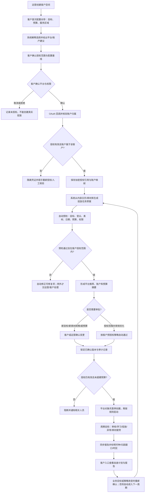

# 多客户广告代运营工作流

## 角色与边界

- **内部运营**维护客户、授权、计划、预算和报告。每一步都按客户空间隔离。
- **客户管理员**通过自己的入口授权广告账户、审核广告计划并查看本客户报告。
- **平台连接器**只在客户主动授权后访问其广告账户。每次读取和写入按平台、客户、广告账户记录。
- **审批闸门**在任何投放变更前预览具体客户、账户、预算、时间和素材。未审批、超预算或授权失效时禁止投放。

## 实际操作流程

首次接入客户时，必须由客户用通俗向导确认经营目标、预算边界、服务区域和广告账户授权。系统根据这些可靠的业务事实推荐宽泛受众，运营人员负责专业微调；不要求客户填写年龄、兴趣或平台标签。设置完成后保存为客户长期基线，后续只有业务变化或越过授权边界时才重新确认。

## 首次客户向导（必须由客户确认）

1. **想要什么结果？** 选销售/订单、网站访问、潜在客户、品牌触达/视频观看、到店或应用安装；旁边用一句话说明“系统会优先优化什么”。
2. **最多愿意花多少？** 让客户选择币种、每日上限、周期总上限和开始/结束日期；清楚展示“按这个设置，最多支出 X”，不能只问模糊的预算金额。
3. **服务哪些地区？** 客户确认门店/服务区域和必须排除的区域即可。系统按目标与区域推荐宽泛受众，运营结合平台能力与实际表现调整；不让客户猜年龄、兴趣或平台标签。
4. **推荐渠道与广告账户** 根据目标、地区、已授权账户和素材可用性推荐；客户确认账户。没有可用授权账户时，先完成授权，不显示可投放承诺。
5. **复核并保存** 用简单摘要复述目标、预算上限、服务区域、渠道/账户授权，以及系统推荐受众的原则。保存为客户投放基线；之后计划默认继承，只有重要变化或触及硬限制才再次请客户确认。

系统推荐必须明确标为建议，客户确认的是经营事实与授权边界，不是专业受众标签。受众的法律/平台限制由系统和运营检查，预算硬上限必须是可执行校验。

## 爱尔兰本地餐厅演示：Harbour Table

原型主线是一家都柏林社区餐厅的工作日晚餐优惠：周一至周四双人套餐、门店周边约 5 km、Meta 已授权账户、客户确认每日最高 €20 和 7 天任务总额 €140。首次接入时，客户确认长期基线（预约/到店目标、服务区域、月度与日预算上限、推荐渠道和账户）；系统根据服务区域推荐受众；运营建立本周优惠任务时只需选优惠内容、日期、预约行动和核销方式，客户基线自动带入。

| 责任方 | 自动/人工步骤 |
|---|---|
| 客户 | 首次确认经营目标、预算上限、门店/服务区域和广告账户授权。客户可告知必须排除的区域或业务限制，但不要求客户猜年龄、兴趣或平台受众标签。新优惠事实、渠道或预算上限改变需要确认。 |
| 运营 | 为本次推广选定 PoStory 内容日历/素材、优惠规则、排期、预约入口和核销方式；依据服务区域和投放表现审阅或微调系统推荐的宽泛受众。运营使用 ChatGPT 优化文案并核实优惠事实，客户不承担文案撰写工作。 |
| 系统 | 根据经营目标与服务区域推荐受众；生成广告素材版本与文案草稿；检查素材、链接、授权、账户、币种、排期与预算；在授权范围内建立并运行任务；周期巡检并汇总数据。 |
| 人工异常队列 | 预算将越界、授权失效、新渠道/新优惠、落地页或素材检查失败、投放异常时暂停并要求运营或客户处理。 |

客户首次向导只收集客户能可靠提供的经营事实（目标、预算边界、服务区域、账户授权）。受众由系统给出宽泛建议，运营人员负责专业调整，避免让客户输入不准确的口语化兴趣标签。单次任务的文案由运营用 ChatGPT 起草和润色，客户只在优惠金额、适用日期、限制等事实需确认时参与。界面显示文案预览与重新生成入口，不提供客户填写文案的必填框。

周报先展示广告花费、优惠券领取、确认预约、实际核销/到店销售。若预约或 POS 数据未接入，核销与销售显示“待回传”；领取和预约不可冒充到店。点击率、点击量、学习状态等平台指标在次级详情展示。原型内的金额、预约和账户状态均为模拟信息。

## 广告术语白话说明

| 术语 | 白话解释 | 在 PoStory 里的用法 |
|---|---|---|
| 投放目标 / Objective | 希望广告帮客户带来什么：订单、访问、线索、观看等 | 客户首次配置时明确选择；任务继承，重要变更再确认 |
| 投放任务 / 简报 | 一次业务需求的“工作单”：推什么、给谁看、何时投、最多花多少 | PoStory 的跨平台业务对象，不直接等于平台 Campaign |
| Campaign / 广告系列 | 平台里的一组广告计划，通常围绕一个目标组织 | 由系统根据投放任务自动创建/复用，后台保存平台 ID |
| Ad Set / Ad Group | 广告系列下面的一组“投放条件”：受众、时间、预算或竞价等 | 各平台叫法与配置位置不同，界面向客户隐藏平台差异 |
| Ad / 广告 | 用户实际看到的内容：图片/视频、文案、按钮和链接 | 从 PoStory 设计稿或素材版本生成，再交平台审核 |
| 受众 / Audience | 广告优先展示给的人群 | 系统按目标和服务区域给出宽泛建议；运营人员审阅并调整，不要求客户猜平台标签 |
| 日预算 / 总预算上限 | 每天最多 / 整段最多愿意花的钱 | 两个硬上限都要保存和校验；上限不代表一定花完 |
| 授权 / OAuth | 客户用自己的平台账号登录，允许 PoStory 在限定范围内操作 | 每位客户单独授权、单独撤销，不共享令牌 |
| 审批 / Approval | 客户或运营对某个具体版本点头 | 必须看到账户、目标、素材和精确预算；改后重新审批 |
| 学习期 / Learning | 平台刚开始测试哪些人更可能响应 | 平台状态，PoStory 展示并监控，不把它当作异常失败 |
| ROAS | 广告归因收入 ÷ 广告花费 | 参考指标，不等同净利润，需和平台归因口径一起看 |
| 自动化规则 / Policy | 预先约定系统允许自动执行的边界 | 在客户确认的预算和策略内自动巡检；越界就停下请人处理 |

常见平台层级可以粗略记为：**Campaign（投什么目标）→ Ad Set / Ad Group（给谁看、怎么投）→ Ad（具体展示什么）**。Google 等平台会因 campaign type 使用不同结构，因此 PoStory 的客户向导使用统一的业务语言，由连接器负责映射平台对象。[Google Ads campaign type](https://developers.google.com/google-ads/api/docs/campaigns/overview?authuser=00&hl=en)、[TikTok ads structure](https://ads.tiktok.com/gateway/docs/index?doc_id=1739381193120770)

## 必须保留的安全不变量

1. 客户空间是授权、广告账户、素材、计划、审批、报告和审计记录的共同隔离边界。
2. 客户主动授权，每个客户可单独撤销；系统不得在不同客户之间复用令牌。
3. 提交前校验账户归属、授权有效期、角色、审批参数摘要和预算上限。
4. 审批绑定计划版本与精确预算。审批后任何参数变化都必须重新审批。
5. 新建平台对象先以暂停状态创建，确认平台回执后再执行允许的状态切换。
6. 每次授权、审批、提交、暂停、预算修改、报告导出均写入含客户 ID 的审计事件。
7. 报告标出数据来源、同步时间、账户币种、时区和平台归因窗口；跨平台合计不能假装币种/归因天然一致。
8. 原型的所有状态仅是本地模拟，不代表真实 OAuth 授权、平台回执、指标或客户身份认证。
